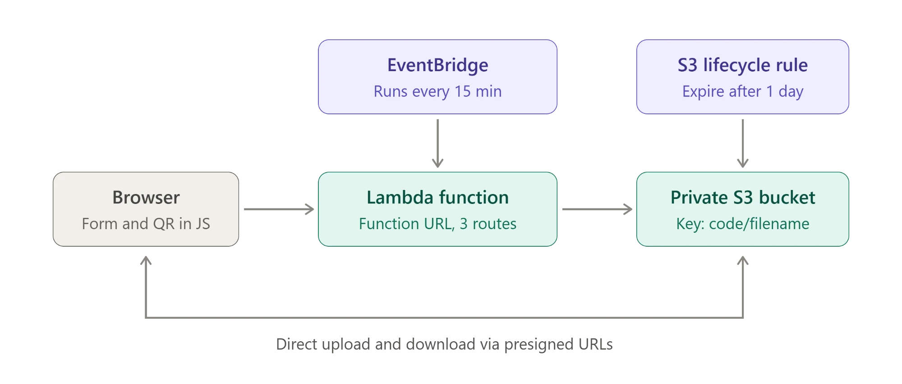

Serverless temporary file sharing on AWS. Upload a file, get a 6-character code, a share link and a QR code. Anyone with the code can download the file until it expires (2 hours in production), after which it is deleted.

One private S3 bucket, one Lambda function behind a Function URL, an EventBridge schedule for cleanup, and an S3 lifecycle rule as a backstop. No database, no API Gateway, no accounts, no servers to manage.

## Features

- Drag-and-drop or click-to-browse upload page, served directly by the Lambda (single Python file, no frontend build)
- Direct browser-to-S3 uploads via presigned POST, so file bytes never pass through Lambda
- 6-character share code, copyable link and QR code, with a live expiry countdown
- Receive tab: enter a code to download
- Short-lived presigned download URLs, delivered as an attachment
- Automatic expiry: enforced at access time, by a scheduled cleanup, and by an S3 lifecycle rule
- Configurable size limit and expiry window

## Architecture



| Component | Role |
| --- | --- |
| **Browser** | Renders the upload form, generates the QR code in JavaScript, and uploads/downloads directly against S3 using presigned URLs. |
| **Lambda function** | Exposed via a Function URL with 3 routes (below). Validates input and signs S3 requests. |
| **Private S3 bucket** | Stores files under the key `code/filename`. Block Public Access stays on. |
| **EventBridge** | Invokes the Lambda every 15 minutes with `{"task":"cleanup"}` to delete expired objects. |
| **S3 lifecycle rule** | Expires objects after 1 day. A backstop only, since S3 lifecycle granularity is whole days. |

### Routes

| Route | Behavior |
| --- | --- |
| `GET /` | Serves the upload/receive page. |
| `POST /upload` | Validates the filename and size, generates a code and returns a presigned S3 POST (valid 5 minutes, with a `content-length-range` condition). |
| `GET /{code}` | Returns `404` if the object is missing or expired, otherwise a `302` to a short-lived presigned GET. |

### Request flow

**Send**
1. The browser calls `POST /upload` with the filename and size.
2. Lambda sanitizes the filename, picks a random code, and returns a presigned POST for `code/filename`.
3. The browser uploads straight to S3 and shows the code, link, QR code and countdown.

**Receive**
1. The user opens `/{code}` (via link, QR code or the Receive tab).
2. Lambda looks up the `code/` prefix in S3, checks that the object has not expired, and redirects to a presigned GET.
3. S3 serves the file as an attachment.

**Expiry**
Expiry is enforced in three layers: on every download, by the 15-minute cleanup run, and by the S3 lifecycle rule as a final backstop.

## Project structure

```
.
├── src/
│   └── lambda_function.py   # Lambda handler, routing, and embedded HTML/JS page
├── tests/
│   └── test_handler.py      # pytest suite (uses moto to mock S3)
├── docs/
│   └── architecture.webp    # Architecture diagram
└── README.md
```

## Configuration

Set these as Lambda environment variables. Nothing in this repository contains account IDs, credentials or deployed URLs, and none should be committed.

| Variable | Required | Meaning |
| --- | --- | --- |
| `BUCKET_NAME` | yes | Private S3 bucket |
| `EXPIRY_SECONDS` | yes | Expiry window, `7200` in production |
| `MAX_UPLOAD_BYTES` | yes | Maximum upload size, enforced in the presigned POST |
| `PRESIGN_GET_SECONDS` | no | Presigned GET lifetime, default `300` |

`AWS_REGION` is provided by Lambda and defaults to `ap-south-1` if unset.

## Prerequisites

- Python 3.12+ (the code uses `X | None` type syntax; 3.10+ is the minimum)
- An AWS account and the [AWS CLI](https://aws.amazon.com/cli/) configured with permissions to create the resources below

## Build and deploy

### 1. Create the S3 bucket

```bash
aws s3api create-bucket --bucket <bucket-name> --region <region> \
  --create-bucket-configuration LocationConstraint=<region>

aws s3api put-public-access-block --bucket <bucket-name> \
  --public-access-block-configuration BlockPublicAcls=true,IgnorePublicAcls=true,BlockPublicPolicy=true,RestrictPublicBuckets=true
```

Add a lifecycle rule that expires objects after 1 day:

```bash
aws s3api put-bucket-lifecycle-configuration --bucket <bucket-name> \
  --lifecycle-configuration '{"Rules":[{"ID":"expire-1-day","Status":"Enabled","Filter":{},"Expiration":{"Days":1}}]}'
```

### 2. Create the Lambda function

Create a Python runtime function with an execution role that allows `s3:PutObject`, `s3:GetObject`, `s3:ListBucket` and `s3:DeleteObject` on the bucket, plus CloudWatch Logs. Set the [environment variables](#configuration), then package and upload the code:

```bash
cd src && zip -r ../function.zip . && cd ..
aws lambda update-function-code --function-name <function-name> --zip-file fileb://function.zip
```

`boto3` is included in the Lambda Python runtime, so there is nothing else to bundle.

Set the handler to `lambda_function.lambda_handler`.

### 3. Add a Function URL

```bash
aws lambda create-function-url-config --function-name <function-name> --auth-type NONE
aws lambda add-permission --function-name <function-name> \
  --statement-id FunctionURLAllowPublicAccess \
  --action lambda:InvokeFunctionUrl --principal "*" \
  --function-url-auth-type NONE
```

### 4. Configure bucket CORS

The browser POSTs directly to S3, so the bucket needs a CORS rule allowing `POST` from the Function URL origin:

```bash
aws s3api put-bucket-cors --bucket <bucket-name> --cors-configuration '{
  "CORSRules": [{
    "AllowedOrigins": ["https://<function-url-id>.lambda-url.<region>.on.aws"],
    "AllowedMethods": ["POST"],
    "AllowedHeaders": ["*"],
    "MaxAgeSeconds": 3000
  }]
}'
```

### 5. Schedule the cleanup

Create an EventBridge Scheduler schedule with rate `rate(15 minutes)` targeting the Lambda with the constant input:

```json
{"task": "cleanup"}
```

### 6. Cap cost and abuse

Set reserved concurrency on the function. This is the abuse and cost cap, since the endpoint is public by design.

```bash
aws lambda put-function-concurrency --function-name <function-name> --reserved-concurrent-executions <n>
```

## Local development

```bash
pip install pytest "moto[s3]" boto3
python -m pytest tests/
```

To iterate on the page, update `PAGE` in `src/lambda_function.py`, redeploy, and reload the Function URL.

## Security model

The service is public by design, so the Lambda validates every input:

- Filenames are sanitized (path components, control characters and unusual characters removed, length capped at 100)
- Size is capped in both the request check and the presigned POST `content-length-range` condition
- Codes use an unambiguous 32-character alphabet, are generated with `secrets`, and are checked against the expected alphabet and length before any S3 call
- Request bodies over 4 KB are rejected
- Responses set `Cache-Control: no-store`, and the page sets `nosniff` and `no-referrer`
- The QR library is loaded from a CDN with a Subresource Integrity hash

Security does not depend on this code being private. Bucket Block Public Access stays on, and anyone holding a code can download that file until it expires, so treat codes like short-lived secrets.

## Limitations

- One file per code
- No password protection or download limits
- Codes are short, so rely on the short expiry window and reserved concurrency rather than secrecy for protection
- Expiry timing is approximate for storage: files stop being downloadable at the expiry time, but physical deletion happens on the next 15-minute cleanup

## License

Add a license of your choice (for example MIT) before publishing.
